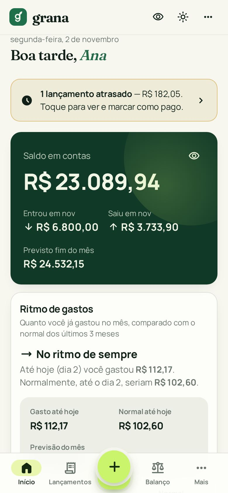
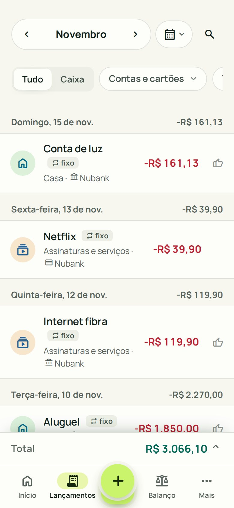
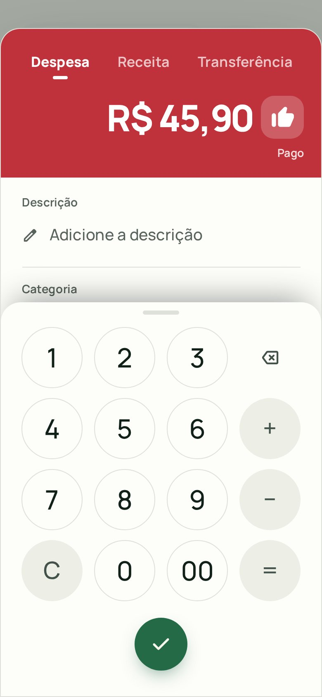
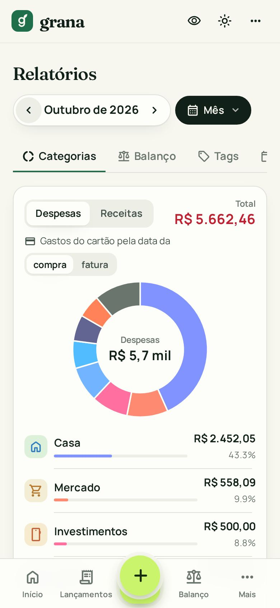
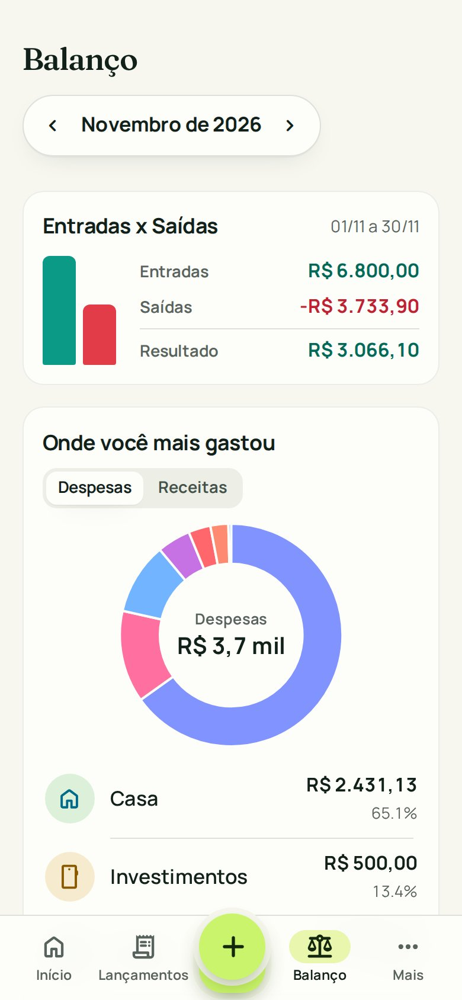
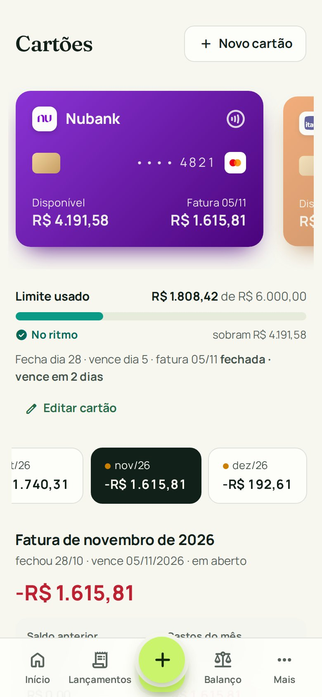
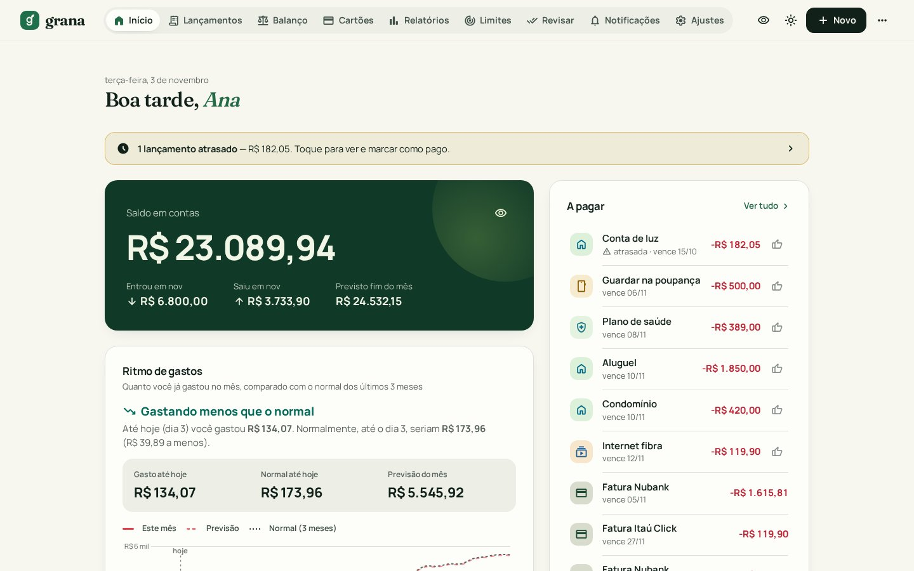

# grana

App pessoal de finanças com infraestrutura **100% gratuita**. Contas, cartões e faturas,
categorias, limites, relatórios e balanço — com lançamentos automáticos a partir das **notificações dos bancos**
no Android e importação via **Open Finance** (MeuPluggy).

- **App web:** https://grana.ferrari-gabriel2002.workers.dev (login Google; instalável como app pelo navegador)
- **Android:** [baixar `grana.apk`](https://grana.ferrari-gabriel2002.workers.dev/grana.apk) — abre o app web em tela
  cheia e roda o coletor de notificações. Ao instalar, permita *Instalar apps desconhecidos*; depois ative
  **grana · coletor** em *Acesso às notificações* (detalhes em [Celular](#4-celular)). APK de depuração, uso pessoal.

<table>
<tr>
<td></td>
<td></td>
<td></td>
</tr>
<tr>
<td></td>
<td></td>
<td></td>
</tr>
</table>



<sub>Prints com dados fictícios (`docs/demo-seed.sql`).</sub>

### Recursos
- **Início** personalizável (arrastar blocos): saldo, previsto do mês, ritmo de gastos vs. últimos meses, a pagar,
  atrasados, 50/30/20.
- **Lançamentos**: despesa, receita, transferência, parcelas e fixos; teclado com calculadora; filtros, busca,
  seleção em lote, arrastar para marcar pago/excluir, desfazer; sugestão de descrição e categoria.
- **Cartões**: limite disponível, faturas por mês com crédito/saldo anterior, **Pagar fatura** (folha com valor,
  conta, data e anexo), **Novo cartão** / **Editar cartão** na própria tela.
- **Relatórios** (categorias, balanço, tags, recorrentes), **Balanço** diário e **Limites** por categoria. No celular,
  tocar no gráfico mostra a categoria e o valor (a rosca mostra no centro); no desktop, clicar abre os lançamentos.
- **Revisar**: fila dos lançamentos que chegaram sozinhos (notificação/Open Finance).
- **Avisos no celular** (Web Push, 08:00): conta a pagar/receber do dia, fatura vencendo ou fechando, limite perto ou
  estourado e, às segundas, o que ficou atrasado.
- **Bancos conectados** (Open Finance via MeuPluggy): passo a passo ilustrado ao conectar e convite no momento certo
  (depois de um lançamento à mão ou de criar uma conta, no máximo a cada 14 dias).
- Tema claro/escuro, ocultar valores, atalhos de teclado no desktop.

**Stack:** Angular (signals, standalone) · Supabase (Postgres + RLS, Auth, Edge Functions, cron) · Cloudflare Workers ·
Android (Kotlin, TWA + NotificationListener) · Pluggy.

```
Android (grana coletor) ──POST texto cru──▶ Supabase Edge Function `ingest` ──▶ Postgres (RLS)
                                               parser + conta/cartão + categoria        ▲
Angular (Cloudflare Workers) ── supabase-js + login Google ─────────────────────────────────┘
```

| Pasta | O quê |
|---|---|
| `supabase/migrations` | schema, regras de fatura, views de saldo/fatura/relatório, RLS, categorias padrão |
| `supabase/functions/ingest` | recebe notificações, parser (`parser.ts`) |
| `supabase/functions/pluggy` | Open Finance (MeuPluggy): token do widget e sincronização (`map.ts`) |
| `supabase/functions/remind` | avisos no celular (Web Push): cron diário e botão de teste |
| `supabase/tests/check.sql` | testes do banco: regra de fatura, saldo, RLS, avisos (roda em transação, rollback no fim) |
| `web/` | app Angular (estrutura abaixo) |
| `android/` | app Android "grana": app web em tela cheia (TWA/Chrome) + coletor de notificações (Kotlin) |

### `web/src/app` — por domínio
```
core/            cliente Supabase, modelos, formatação (brl, datas), estado de UI (tema, toast), Store
shared/ui/       componentes sem regra de negócio: ícones, campos (valor, teclado, data, seletor), gráficos
shared/banks.ts  catálogo de bancos/bandeiras e logo
features/
  home/          visão geral (ritmo, para onde foi, a pagar, 50/30/20)
  transactions/  lista, filtros, períodos, seleção em lote, formulário (tx-form)
  cards/         cartões e faturas (invoice.ts: regra da fatura, igual à do banco, e situação)
  reports/       relatórios, balanço, tags, recorrentes (recurring.ts)
  budgets/       limites de gastos
  notifications/ notificações coletadas no celular
  settings/      contas, cartões, categorias, tags, segurança
  banks/         Open Finance: tela e guia (open-finance.ts); sincronizar e convite (pluggy.ts, leve)
```
Regras: `features/*` importam de `core` e `shared`; de outra feature, só arquivos sem tela (`cards/invoice.ts`,
`banks/pluggy.ts`). `shared` não importa de `features`.
Código: 4 espaços, Prettier + ESLint (angular-eslint, acessibilidade nos templates):
`cd web && npm run lint && npm run format:check` (`npm run format` corrige).

## Desenvolvimento local
```bash
npx supabase start -x studio,imgproxy,vector,logflare,realtime,postgres-meta,supavisor,mailpit   # storage-api fica: anexos
npx supabase functions serve            # outro terminal
cd web && npm i && npx ng serve          # http://localhost:4200 (login dev por e-mail/senha)
```
Testes: `cd web && npm test` e
`docker exec -i supabase_db_grana psql -U postgres -v ON_ERROR_STOP=1 < supabase/tests/check.sql`.

Testes de tela (Playwright, 9 roteiros / ~140 verificações, celular e desktop) contra o app local
(`ng serve` + Supabase local com o usuário dev abaixo): `cd web && npm run e2e` (ou `npm run e2e -- lacunas`
para um só). Prints vão para `/tmp/grana-e2e`. Variáveis: `TARGET_URL`, `TEST_EMAIL`, `TEST_PASSWORD`, `OUT_DIR`.

Usuário dev local: crie com
`curl -X POST http://127.0.0.1:54321/auth/v1/admin/users -H "apikey: $SERVICE_ROLE" -H "Authorization: Bearer $SERVICE_ROLE" -H 'content-type: application/json' -d '{"email":"dev@grana.local","password":"devdev123","email_confirm":true}'`
(`SERVICE_ROLE` = `npx supabase status -o env | grep SERVICE_ROLE_KEY`).
Dados fictícios (prints/demonstração): crie `demo@grana.local` / `demodemo123` do mesmo jeito e rode
`docker exec -i supabase_db_grana psql -U postgres < docs/demo-seed.sql`.

Celular contra o Supabase local: `adb reverse tcp:54321 tcp:54321` e endpoint `http://127.0.0.1:54321/functions/v1/ingest`.

## Deploy (tudo grátis)

Produção atual: Supabase `mfsblnrygzwdefvnezas`, Google Cloud `grana-513513`, Cloudflare Worker `grana`.

### 1. Supabase
1. Crie um projeto em supabase.com (região São Paulo).
2. `npx supabase login && npx supabase link --project-ref SEU_REF`
3. Banco: `npx supabase db push --remote`.
4. Funções: `npx supabase functions deploy ingest --no-verify-jwt`, `npx supabase functions deploy pluggy` e
   `npx supabase functions deploy remind`.
5. Segredos (`npx supabase secrets set …`): `PLUGGY_CLIENT_ID` e `PLUGGY_CLIENT_SECRET` (veja `docs/pluggy.md`) e
   `VAPID_KEYS` (par de chaves dos avisos em JWK, gerado com `exportVapidKeys` do `@negrel/webpush`; a chave pública vai
   em `vapidPublic` de `web/src/env*.ts`).
6. Crons (sincronização 07:00, avisos 08:00): no SQL Editor rode uma vez
   `select vault.create_secret('<service_role key>', 'grana_service_role');`. Tem que ser a mesma chave de
   `SUPABASE_SERVICE_ROLE_KEY`: as funções `pluggy` e `remind` comparam com ela. Sem isso, nada roda sozinho.
   A URL do projeto está fixa nos agendamentos (`20261102060000_pluggy.sql` e `20261102100000_push.sql`): troque se
   usar outro projeto.

### 2. Login com Google
1. console.cloud.google.com → APIs e serviços → Tela de consentimento OAuth: Externo; adicione seu Gmail como usuário de teste
   (escopos básicos email/perfil não precisam de verificação).
2. Credenciais → Criar ID do cliente OAuth → Aplicativo da Web. URI de redirecionamento autorizado:
   `https://SEU_REF.supabase.co/auth/v1/callback`
3. Supabase → Authentication → Sign In / Providers → Google: cole Client ID e Secret.
4. Supabase → Authentication → URL Configuration: Site URL = URL do Cloudflare Pages (passo 3).
5. **Depois do seu primeiro login**, desligue "Allow new users to sign up" (Authentication → Sign In / Providers).
   Assim só você entra; o RLS já isola os dados por usuário de qualquer forma.

### 3. Frontend (Cloudflare Workers, assets estáticos — grátis)
1. `web/src/env.prod.ts` tem Project URL + publishable key (públicas; RLS protege os dados).
2. `cd web && npm run deploy` (build + `wrangler deploy`; config em `web/wrangler.jsonc`, SPA fallback ligado; leva junto o
   `grana.apk` se ele já estiver compilado). **Sempre depois do `db push`**: o app chama funções SQL das migrations novas.
3. No ar: https://grana.ferrari-gabriel2002.workers.dev — Site URL e Redirect URL (`…/**`) já cadastrados no Supabase.

### 4. Celular
Um APK só (`dev.grana.coletor`): o ícone **grana** abre o app web em tela cheia (Trusted Web Activity no Chrome;
o login Google funciona, em WebView não) e o mesmo app roda o coletor de notificações em segundo plano.
A tela do coletor não tem ícone: **toque longo em grana → Configurar coletor**, ou pelo link `grana://setup`.

1. Build: `cd android && ./gradlew assembleDebug` → `android/build/outputs/apk/debug/grana-coletor-debug.apk`.
2. Instalar: `adb install -r android/build/outputs/apk/debug/grana-coletor-debug.apk`, ou copie o APK para o celular e
   abra (permita *Instalar apps desconhecidos* para o app de arquivos). Use sempre a mesma chave
   (`~/.android/debug.keystore`): assim o `-r` mantém dados e acesso às notificações, e a digital continua batendo com
   `web/public/.well-known/assetlinks.json` (é o que tira a barra de URL; trocou de chave → gere o SHA-256 com
   `keytool -list -v -keystore ~/.android/debug.keystore -alias androiddebugkey -storepass android` e atualize o arquivo).
3. Configurar o coletor: no app web, **Notificações → Gerar token** e toque no link `grana://setup?endpoint=…&token=…`.
   O coletor abre com endpoint e token **preenchidos, mas nada salvo**: confira o endpoint
   (`https://SEU_REF.supabase.co/functions/v1/ingest`) e toque em **Confirmar configuração**, depois **Enviar teste**.
   Qualquer página pode disparar esse link, por isso ele nunca salva sozinho. Sem o link: cole endpoint e token na tela
   e toque em Salvar. (Via `adb shell am start -n dev.grana.coletor/.MainActivity --es endpoint … --es token …` só
   funciona com o app sem token; para trocar use a tela ou `adb shell pm clear dev.grana.coletor`.)
4. Samsung: *Configurações → Notificações → Configurações avançadas → Acesso às notificações do dispositivo* → ative
   **grana · coletor**. *Aplicativos → grana → Bateria → Não restringir*; em *Bateria → Limites de uso em segundo plano*
   coloque em **"Aplicativos que nunca entram em suspensão"**.
5. Em **Ajustes** do app web, preencha em cada conta/cartão o **app que notifica** e o **final do cartão**.
   Com isso as notificações viram lançamentos automáticos; o que não casar fica em **Notificações** para revisar.
   Quando um banco mandar um formato que o parser não entende, copie o texto para `parser.test.ts` e ajuste `parser.ts`.
6. Avisos: **Ajustes → Avisos no celular → Ativar avisos** e depois **Enviar teste**. O aviso chega como notificação do
   Chrome (site grana); se não chegar, confira se o Chrome pode mostrar notificações.


## Cuidados do plano grátis
- Supabase pausa o projeto após **7 dias sem atividade** — o coletor enviando notificações mantém ativo.
- Plano grátis não tem backup automático: rode `npx supabase db dump --data-only > backup.sql` de vez em quando.
- A API do Supabase devolve no máximo 1000 linhas por consulta: relatórios e saldos usam funções SQL agregadas, e as
  listas longas (Lançamentos, recorrentes) buscam em páginas de 1000 (`allRows` em `web/src/app/core/supabase.ts`).

## Opções de banco gratuito avaliadas
| Opção | Grátis | Prós | Contras |
|---|---|---|---|
| **Supabase** (escolhido) | Postgres 500 MB, Auth, 500 mil funções/mês | Login Google, RLS e API REST prontos: zero backend de CRUD | pausa após 7 dias parado; sem backup no free |
| Cloudflare D1 + Workers | 5 GB, 5 mi leituras/dia | nunca pausa, você já usa wrangler | SQLite; login Google e API CRUD escritos à mão |
| Neon | Postgres 0,5 GB | scale-to-zero, branches | só banco (sem auth/API) |
| Turso | SQLite ~5 GB | rápido na edge | só banco |
| Firebase | Firestore 1 GB + Auth | login Google trivial | NoSQL ruim p/ relatórios; Functions exigem plano Blaze (cartão) |
| MongoDB Atlas M0 | 512 MB | — | só banco, NoSQL |

## Conexão com bancos (Open Finance)
Direto com o banco não dá (só instituições autorizadas pelo Banco Central). Via **Pluggy/MeuPluggy** dá, grátis para
uso pessoal: veja o passo a passo em [`docs/pluggy.md`](docs/pluggy.md). No app: *Ajustes → Bancos conectados*.
